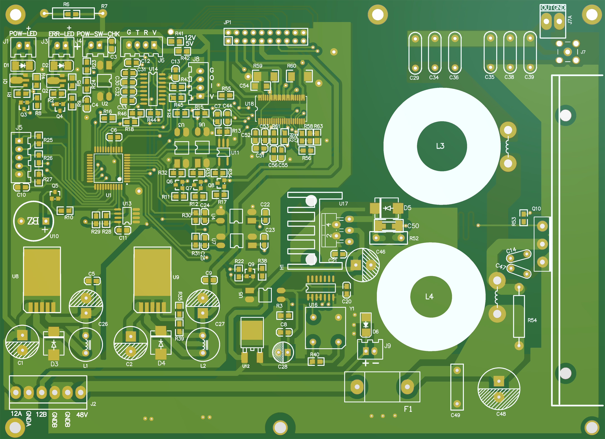
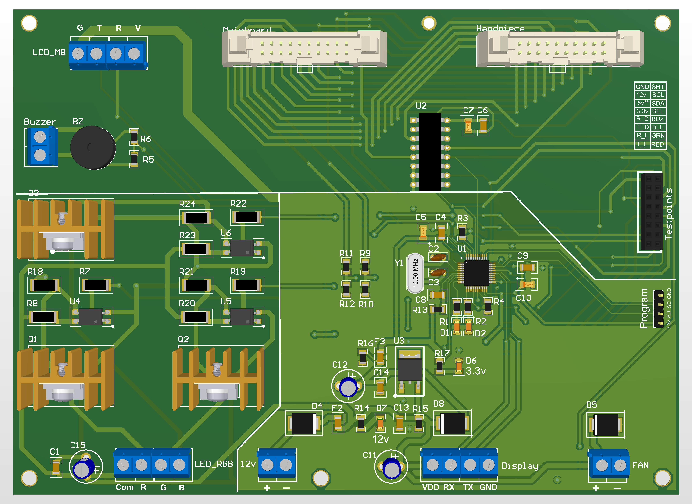
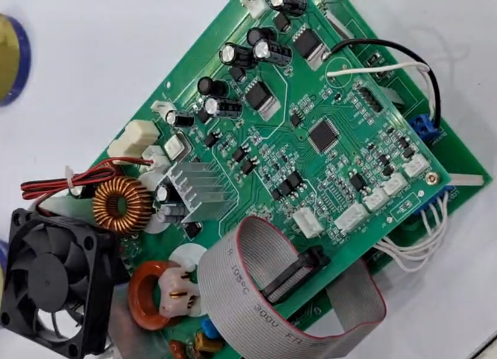
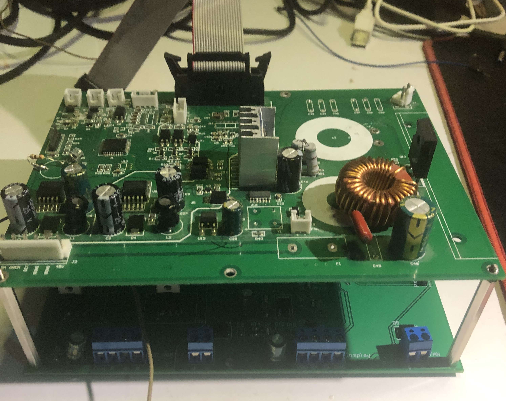
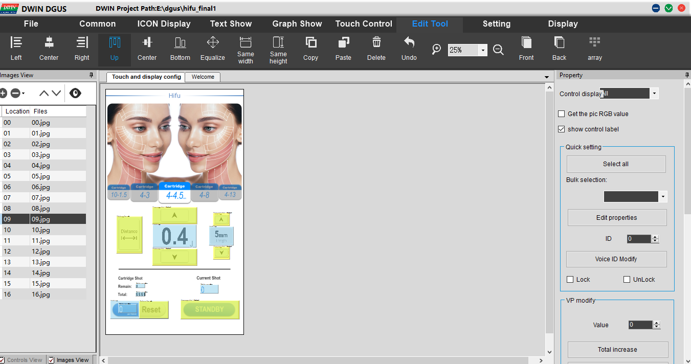
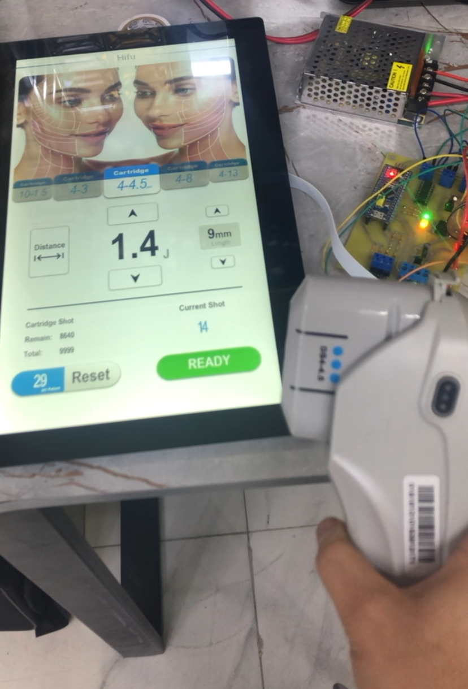

# HIFU Device — Electronics, Firmware and HMI Development

**Embedded Systems and Electronic Hardware Development**  
*Reverse Engineering · Analog and Digital PCB Design · STM32 Control Firmware · Touchscreen HMI*

## Overview

This project presents the **reverse engineering and redevelopment of the electronic control system of a high-intensity focused ultrasound (HIFU) device**. The work involved analyzing the existing platform, redesigning its electronics, developing embedded control firmware, creating a custom touchscreen interface, and integrating the resulting subsystems into an operational device.

The hardware is built around **two custom-designed, interconnected PCBs** that combine analog and digital circuitry in a compact, stacked assembly. An **STM32F103C8T6 microcontroller**, programmed in C, manages the device's embedded-control functions and communication with the touchscreen HMI.

**I carried out the hardware development, STM32 firmware implementation, HMI design, and system integration.** This repository documents that work through source code, PCB visualizations, assembled-board photographs, interface screenshots, and a video demonstration of the operating device.

## System Architecture

The system integrates electronic control, peripheral interfaces, and operator interaction across two interconnected circuit boards.

| Subsystem | Engineering implementation |
| --- | --- |
| **Electronic hardware** | Two custom PCBs combining analog and digital circuits, with inter-board connections and a stacked mechanical arrangement |
| **Embedded controller** | STM32F103C8T6 running C firmware developed with STM32CubeMX, STM32 HAL, and Keil µVision |
| **Peripheral control** | GPIO, timers/PWM, I²C, and UART interfaces configured for the device's electronic subsystems |
| **Operating logic** | Handpiece and cartridge status handling, operating sequences, timing, event counters, and status indications |
| **Human–machine interface** | Custom DWIN DGUS touchscreen interface connected to the embedded controller |

The STM32 firmware coordinates the device's operating states and peripheral interactions, while the HMI provides a visual interface for operator commands and status information. The hardware, firmware, and interface were developed and integrated as a unified electronic control platform.

## Hardware Development and Integration

The electronic redesign comprises **two populated PCBs mounted in a stacked configuration**. The arrangement integrates the analog and digital circuits while providing the electrical connections needed between the boards and the rest of the device.

  
  

<em>Custom PCB designs: main board (left) and second board (right).</em>

  
  

<em>Fabricated and assembled electronics, showing the dual-board architecture.</em>

The development also included a separate **EMI/EMC investigation PCB**, documented through a 3D design view and assembly photograph. The finished electronic assembly was integrated into the HIFU device enclosure alongside the touchscreen and associated hardware.

[Explore the hardware development and PCB documentation](hardware/README.md).

## STM32 Firmware Development

The embedded application was developed in **C for the STM32F103C8T6** and organized as an STM32CubeMX/STM32 HAL project with a Keil µVision development configuration.

The firmware implementation includes:

- **Device-state management:** Operating-state transitions and coordination of the device's electronic functions.
- **Handpiece and cartridge handling:** Interface signals, connection-related conditions, and associated status logic.
- **Timing and usage tracking:** Timer-based operations and counters associated with device activity.
- **Peripheral communication:** UART-based data exchange, including touchscreen communication, together with configured I²C and GPIO interfaces.
- **Timer/PWM control:** Hardware timer configuration and PWM-driven outputs used by the application.
- **Status and indication logic:** Controller-managed indicator behavior and event-related notifications.

The repository includes the application sources, STM32CubeMX configuration, Keil project files, and supporting HAL/CMSIS components.

[Explore the STM32 firmware](firmware/README.md).

## Touchscreen HMI Development

A custom **DWIN DGUS touchscreen HMI** was designed and integrated with the STM32 controller. The interface provides access to device operating screens, controls, and visual status information through a dedicated display.

  
  

<em>Touchscreen interface development in DWIN DGUS (left) and testing on the connected display (right).</em>

The HMI and firmware were developed together to support communication between operator inputs, the device controller, and the displayed operating information.

[Explore the HMI design and integration](hmi/README.md).

## Integrated Device and Demonstration

The completed electronic system was assembled and integrated into the HIFU device. The video below documents the developed device operating and demonstrating the assembled prototype.

  

<em>Operational touchscreen shown in the working-device demonstration.</em>

**[Watch the working HIFU device on YouTube](https://youtube.com/shorts/ZNVhH4hBH6o?feature=share)** · [Results and Media](results-and-media/README.md)

## Engineering Contributions

- **Reverse engineering and redesign:** Evaluated the existing electronic platform and developed a revised hardware and control implementation.
- **Analog and digital electronics:** Designed two custom PCBs, implemented their interconnections, and integrated the populated boards into a stacked assembly.
- **Embedded software:** Developed STM32F103C8T6 firmware in C, including peripheral configuration, communication, timing, and operating-state logic.
- **Human–machine interface:** Designed and integrated a DWIN DGUS touchscreen interface with the embedded controller.
- **Hardware prototyping:** Developed an additional PCB for EMI/EMC investigation and performed electronic assembly and integration.
- **System realization:** Integrated the electronics, firmware, and interface into the completed device and documented its operation.

## Repository Sections

| Section | Description |
| --- | --- |
| **[Hardware](hardware/README.md)** | PCB 3D visualizations, assembled boards, dual-board integration, and EMI/EMC investigation hardware. |
| **[Embedded Firmware](firmware/README.md)** | STM32 C source code, CubeMX configuration, Keil project, and required HAL/CMSIS components. |
| **[HMI Development](hmi/README.md)** | DWIN DGUS interface design, touchscreen integration, and development screenshots. |
| **[Results and Media](results-and-media/README.md)** | Operational device demonstration and photographs of the integrated system. |

---

## Copyright and Citation

Copyright © 2026 Mostafa Amiri. All rights reserved for original contributions.

This repository is publicly accessible for engineering documentation and professional portfolio purposes. **No general open-source license is granted for the original project materials.** Third-party software components remain subject to their respective licenses.

For reuse permissions, see [Copyright and Permissions](COPYRIGHT.md). For attribution, see [CITATION.cff](CITATION.cff).

---

**Electronics, embedded firmware, HMI, and system integration:** [Mostafa Amiri](https://github.com/Mostafaa-Amiri).
