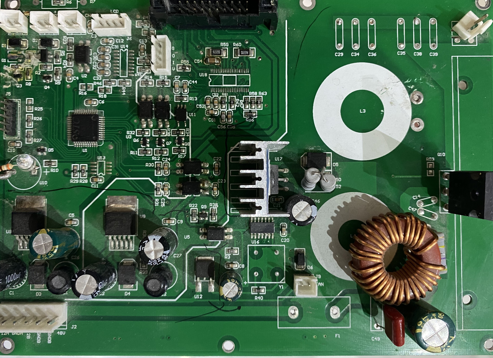
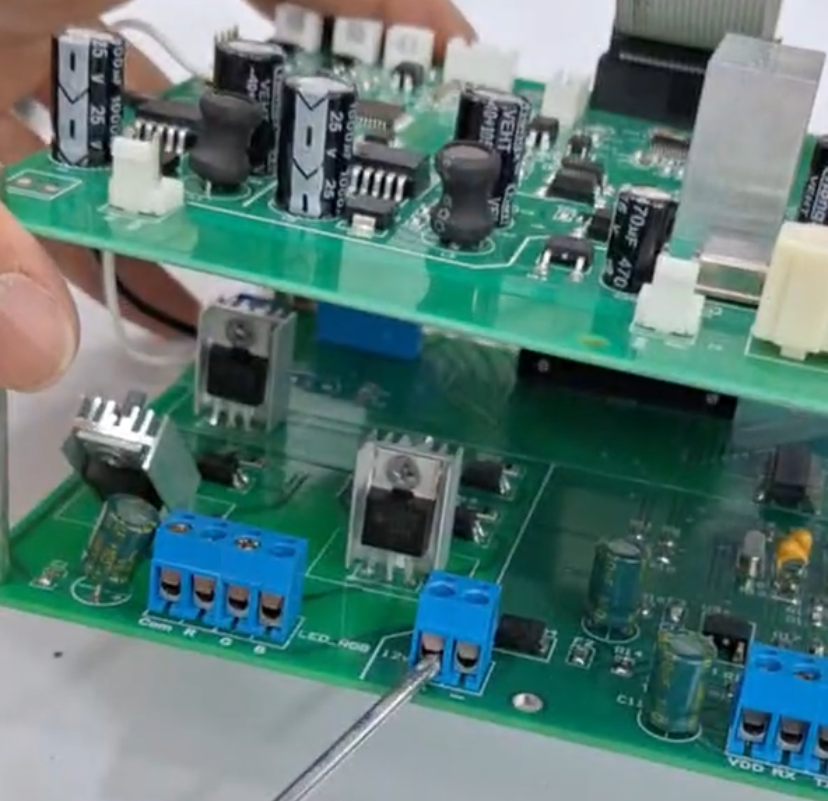
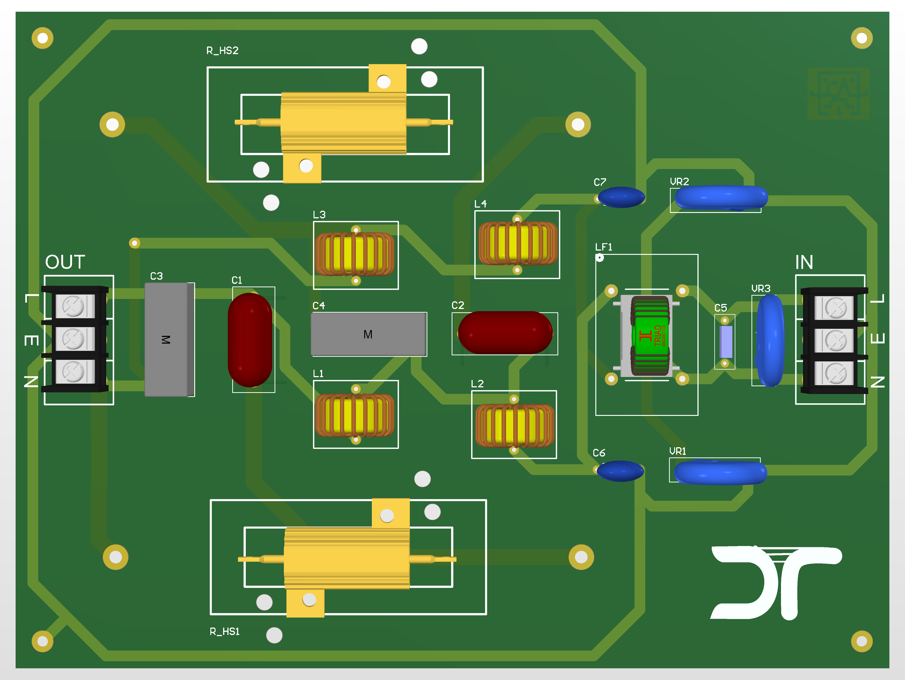
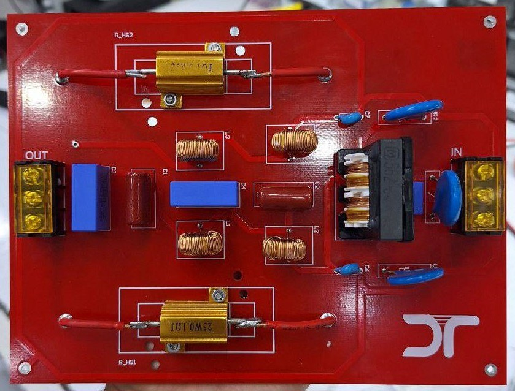

# Hardware Development — HIFU Device

**HIFU Device · Electronics, Firmware and HMI Development**

## Overview

The electronic hardware uses **two interconnected circuit boards in a stacked assembly**, developed to accommodate analog and digital functionality. The figures below document PCB design, populated boards, integrated assembly, and an additional board used for EMI/EMC-related experimentation. **Only renders and photographs are shared; editable schematic and PCB design files are not included.**

## PCB Design and Assembly

### Main board

### Second board

### Interconnected two-board assembly

## EMI / EMC Test Board

This separate prototype is documented as part of the electronic development and investigation process. The photographs do not constitute a formal EMC compliance test report.

## Related Documentation

[Project overview](../README.md) · [STM32 firmware](../firmware/README.md) · [HMI development](../hmi/README.md)
