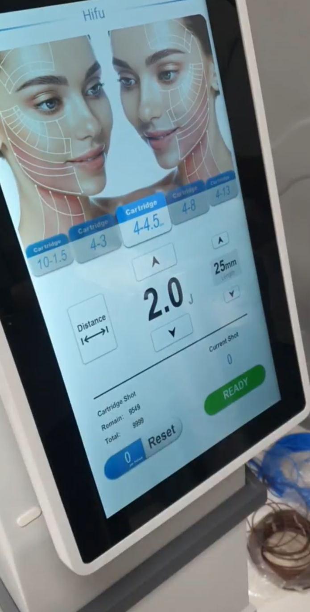
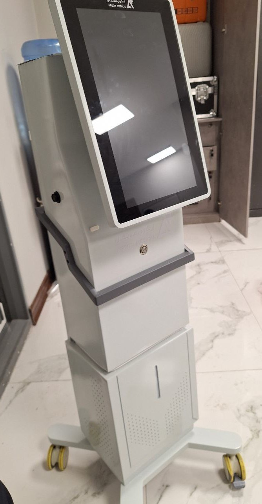

# Results and Media — HIFU Device

**HIFU Device · Electronics, Firmware and HMI Development**

## Overview

This section presents visual documentation of the developed HIFU device, including a working-device demonstration and photographs of the integrated hardware and enclosure.

## Device Demonstration

The linked video shows the **developed device in operation**, including the integrated touchscreen interface. It documents the engineering implementation, not clinical treatment effectiveness or regulatory approval.

  

**[Watch the HIFU device demonstration on YouTube](https://youtube.com/shorts/ZNVhH4hBH6o?feature=share)**

## Integrated Device

*Assembled device enclosure and touchscreen display.*

## Related Documentation

[Project overview](../README.md) · [Hardware development](../hardware/README.md) · [STM32 firmware](../firmware/README.md) · [HMI development](../hmi/README.md)
